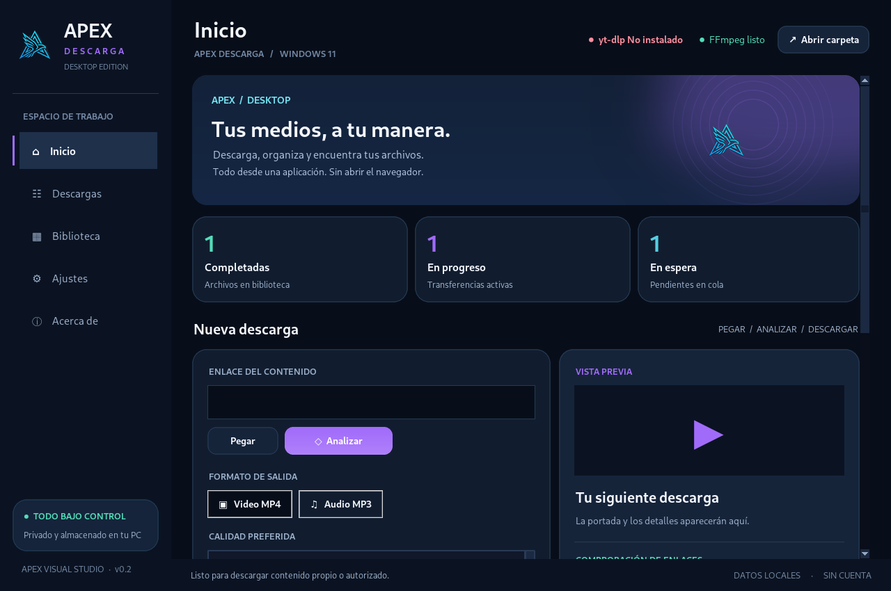

# Apex Descarga Desktop 0.2 UI Pro — Windows 11

**Aplicación independiente de Brave**, desarrollada por **Apex Visual Studio**. Esta entrega cambia la experiencia visual conservando la descarga con yt-dlp/FFmpeg, la cola, el historial local y las preferencias previas de Desktop 0.1.

## Novedades de UI Pro

- Barra lateral con **Inicio, Descargas, Biblioteca, Ajustes y Acerca de**.
- Interfaz oscura con superficies redondeadas, portada, banner propio y estadísticas de actividad.
- Descargas en tarjetas con estados, progreso, velocidad, ETA, cancelar, reintentar y abrir archivo/carpeta según disponibilidad.
- Biblioteca con búsqueda y filtros de **Video / Audio**; abrir, copiar ruta o **quitar únicamente el registro** (sin borrar el archivo descargado).
- Ajustes de tema, color HEX libre, logotipo opcional, modo compacto, selección de carpeta y diagnóstico de motores.
- Contacto y sugerencias: **angelrlpz030207@gmail.com**.

## Usar el `.exe` (método recomendado)

1. En GitHub abre [Apex Desktop — Windows 11 Actions](https://github.com/Sombra-789/apex-descarga/actions/workflows/desktop-windows.yml).
2. Abre la ejecución **verde** más reciente de la versión 0.2.
3. Descarga el artefacto ZIP de `ApexDescargaDesktop-0.2-Windows11-UI-PRO-BETA-NO-FIRMADO`.
4. Extrae el ZIP y analiza `ApexDescargaDesktop.exe` con Microsoft Defender.
5. Abre el `.exe`. **No requiere instalar Python** ni tener Brave abierto.
6. Para convertir MP3 o unir video HD, FFmpeg debe estar en el `PATH` o `bin/ffmpeg.exe` junto al EXE. Para determinados sitios se necesita Deno instalado.

Este ejecutable **no tiene firma Authenticode** y es una **beta**, no un instalador oficial de producción. Si SmartScreen muestra una advertencia inesperada, no desactives la seguridad general de Windows para abrirlo; comprueba la procedencia y el SHA-256.

## Ejecutar el proyecto fuente

Requisitos: Windows 11, Python 3.11, 3.12 o 3.13, internet. Puedes mantener Python 3.15, pero el iniciador no lo utiliza para evitar errores de compatibilidad.

1. Extrae todo el paquete ZIP, sin ejecutar archivos desde la ventana del ZIP.
2. Ejecuta `INICIAR_APEX.cmd`, **sin administrador**. Detecta Python compatible, crea `.venv` e instala yt-dlp y Pillow.
3. Si no tienes Python 3.12: `winget install -e --id Python.Python.3.12`; cierra y reabre PowerShell.
4. Para generar EXE local, después ejecuta `BUILD_EXE_WINDOWS.cmd` y encontrarás `dist/ApexDescargaDesktop.exe`.

En el escritorio el programa crea datos en `%LOCALAPPDATA%\ApexDescargaDesktop\`. El rediseño **reutiliza las preferencias e historial de 0.1**. Evita borrar esa carpeta si quieres conservarlos.

## Pantallas reales de esta entrega

| Inicio | Descargas | Biblioteca | Ajustes | Acerca de |
|---|---|---|---|---|
| [Vista](docs/preview_inicio.png) | [Vista](docs/preview_cola.png) | [Vista](docs/preview_biblioteca.png) | [Vista](docs/preview_ajustes.png) | [Vista](docs/preview_acerca.png) |

## Límites de esta beta

- Cola **secuencial**, sin pausa exacta ni descargas paralelas.
- Si cierras Apex durante una descarga se interrumpe; el historial permite reintentarlo.
- Los datos de portada, formatos, duración y compatibilidad dependen de los sitios y de yt-dlp.
- FFmpeg y Deno **no están integrados** en el `.exe` de prueba.
- La biblioteca muestra archivos creados por Apex, no escanea todo el disco. **Quitar registro no borra el archivo.**
- Es software para descargar **contenido propio o autorizado**; no elude DRM.

## Seguridad, licencias y privacidad

Apex Desktop no integra una cuenta o servidor de telemetría propio. Los enlaces/portadas son consultados a las plataformas origen mediante yt-dlp/HTTP, y el historial permanece local en el equipo. Lee las condiciones del contenido y no compartas claves de sesión, contraseñas o enlaces privados al reportar fallos.

Dependencias: **yt-dlp** (Unlicense), **Pillow** (HPND), **PyInstaller** (GPL con excepción de bootloader). FFmpeg tiene obligaciones LGPL/GPL dependiendo de cada compilación externa; los binarios FFmpeg/Deno no se distribuyen en este paquete. La marca Apex Visual Studio pertenece a su titular. Para reportar errores y sugerencias: **angelrlpz030207@gmail.com**.

**Proyecto:** https://github.com/Sombra-789/apex-descarga
**Cambios:** [CHANGELOG.md](CHANGELOG.md)
**Pruebas:** [PRUEBAS_WINDOWS_11.md](docs/PRUEBAS_WINDOWS_11.md)
